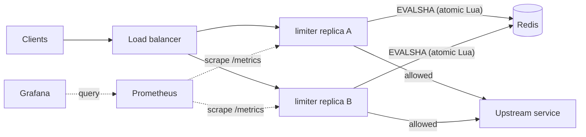
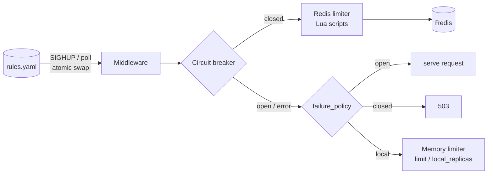
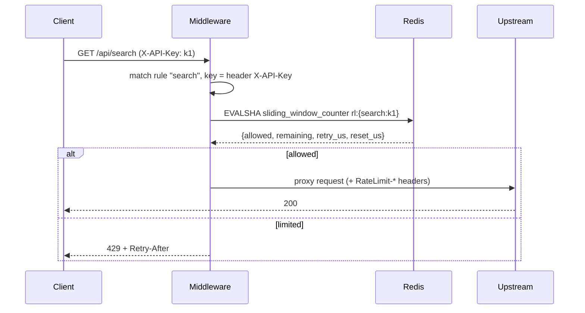
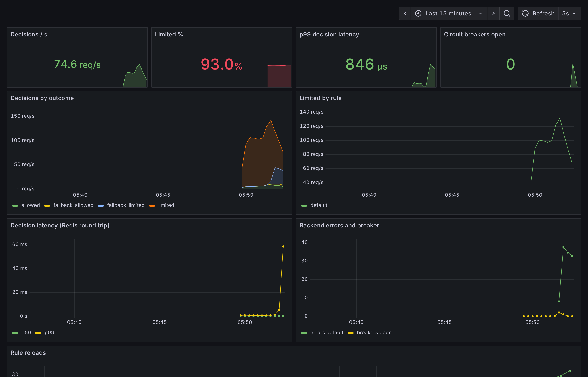

# RateLimiter

A distributed API rate limiter in Go, backed by Redis. Any number of app replicas share one Redis, and limits hold across all of them. Each decision is a single atomic Lua script that takes about 30 µs.

It ships as a gateway you can run in front of any HTTP service (`UPSTREAM_URL`), or as Go middleware you can drop into your own server.

- **Three algorithms:** token bucket, sliding window log and sliding window counter, chosen per route.
- **Atomic and skew-proof:** every check is one Redis Lua script that reads the clock with Redis `TIME`, so there are no read-modify-write races and no reliance on app server clocks.
- **Per-route YAML rules:** match on path prefix and method, then limit by client IP, API key header or a global budget. Rules can also give a request a weighted cost.
- **Standard headers:** `RateLimit-Limit`, `RateLimit-Remaining`, `RateLimit-Reset` and `RateLimit-Policy` (IETF draft), plus `Retry-After` on `429`.
- **Graceful degradation:** if Redis is down, fail open (serve traffic), fail closed (`503`), or fail **local**: keep limiting with an in-process limiter on each replica that makes the same decisions as the Lua scripts. A circuit breaker stops paying the Redis timeout on every request during an outage.
- **Shadow rules:** mark a rule `shadow: true` to run a candidate limit on live traffic next to the one in force. Would-be rejections are counted and logged, but never enforced.
- **Any Redis topology:** standalone, Sentinel (follows failovers) or Cluster (`REDIS_MODE`). Keys carry a hash tag, so every Lua script stays on one slot; integration tests check exact limits on a 3-master cluster and across a live Sentinel failover.
- **Hot reload:** edit `rules.yaml` and send `SIGHUP` (or let it poll). Invalid edits are rejected and the last good rules stay in force.
- **Observability:** Prometheus metrics for decisions, latency, backend errors, breaker state and reloads, a provisioned Grafana dashboard, `/healthz`, `/readyz`, and a token-protected `/admin/rules` that shows the rules in force and the hash of the file they came from.
- **Load tested:** k6 against two replicas lets through 319 of 6,000 requests where the configured limit allows 320, with p99 under 1.5 ms; with Redis stopped mid-run the local fallback holds the same ~11 req/s and no request fails (see [Load test results](#load-test-results)).
- **Tested:** 136 test cases plus a fuzz target, golangci-lint clean. Property tests drive random traffic through both backends and check that no window ever admits more than the algorithm allows, a differential test checks the in-memory fallback matches the Lua scripts decision for decision, and a concurrency test against real Redis fires 500 requests at once and checks that exactly 100 get through.

## Architecture



Inside a replica, the Redis limiter sits behind a circuit breaker, with an in-process limiter as the fallback:



Request flow inside one replica:



## Algorithms and trade-offs

| Algorithm | Redis state per key | Accuracy | Bursts | Good for |
|---|---|---|---|---|
| `token_bucket` | 1 hash (2 fields) | Exact | Allowed up to `burst`, then refills at `limit/window` | General API traffic |
| `sliding_window_log` | 1 sorted set, one entry per request | Exact, with no window-boundary bursts | No | Low limits that must be exact (login, OTP) |
| `sliding_window_counter` | 1 hash (3 fields) | Approximate: weights the previous window linearly | No | High limits where memory matters |

A **fixed window** counter lets a client send 2× the limit across a window boundary. Both sliding algorithms avoid that. The log version is exact but stores one entry per request. The counter version uses constant memory and assumes requests in the previous window were spread evenly.

**Why Lua plus Redis `TIME`?** Rate limiting is read-then-write. If two replicas each read "9 of 10 used" before either writes, both allow, and you get 11. A Lua script runs atomically on Redis, so that can't happen (`TestConcurrentAtomicity` checks this). Reading the time inside the script means every replica uses one clock, so skewed app servers can't hand out extra tokens.

**Keys** look like `rl:{rule:client}:tb` (`:swl`, `:swc` for the other algorithms). The braces form a Redis Cluster hash tag, so each script touches exactly one slot. The algorithm suffix sits outside the tag: when a reload switches a rule's algorithm, it starts from fresh state instead of hitting a `WRONGTYPE` error on the old key. Every key gets a TTL that matches its window, so idle clients cost no memory.

## When Redis goes down

A rate limiter that depends on Redis has to decide what an outage means. There are three policies, set with `failure_policy`:

| Policy | During an outage | Choose it when |
|---|---|---|
| `open` | Every request is served, unlimited | Availability matters more than protection |
| `closed` | Every limited route returns `503` + `Retry-After: 1` | Protecting the upstream matters more than availability |
| `local` | Each replica limits on its own, in memory | You want both: abusive clients stay limited, normal clients are served |

**`local` in detail.** Each replica holds a `MemoryLimiter` that implements the same three algorithms with the same arithmetic as the Lua scripts (`TestMemoryMatchesLua` replays random traffic through both and checks every decision matches). State is per replica, so with N replicas behind a round-robin balancer a client could get N times its limit. `local_replicas: N` divides each limit by N (never below 1, never below the rule's cost) to keep the fleet-wide total close to the configured one. The fallback starts empty, so a client gets a fresh budget at the moment Redis fails; that is the trade for not needing any shared state.

**Circuit breaker.** Without one, every request during an outage waits the full `REDIS_TIMEOUT` before the policy applies, which adds 50 ms to every request exactly when the system is under stress. After `BREAKER_FAILURES` consecutive errors the breaker opens and calls fail instantly for `BREAKER_COOLDOWN`. Then a single trial request goes to Redis (half-open): success closes the circuit, failure re-opens it. Invalid rules and cancelled client requests don't count as failures. `ratelimiter_breaker_open` shows the state.

## Hot reload

The rules file is reloaded on `SIGHUP`, and also every `RULES_RELOAD_INTERVAL` when that is set (docker-compose uses 10s). Reload compares a SHA-256 of the file, so polling is cheap and works with Kubernetes ConfigMap symlink swaps, where file-watch events are unreliable. New rules are validated with the same strict parser as startup and swapped in atomically: requests in flight finish with the rules they started with, and a broken file is logged, counted as `rejected` and ignored.

```bash
vim config/rules.yaml && docker compose kill -s HUP limiter-a limiter-b
```

To check what each replica is actually enforcing, set `ADMIN_TOKEN` and ask it. The response carries the SHA-256 of the file and when it was loaded, so comparing replicas after a rollout is one `curl` each. The rules, hash and load time are swapped as one value, so the hash always describes the rules shown.

```bash
curl -s -H "Authorization: Bearer $ADMIN_TOKEN" localhost:8081/admin/rules | jq '{sha256, loaded_at, failure_policy}'
```

Without `ADMIN_TOKEN` the endpoint answers `404`, and a wrong token gets `401` (compared in constant time). Like the health and metrics routes it is never rate limited, so in proxy mode `/admin/rules` is not forwarded upstream.

## Quick start

```bash
docker compose up --build        # Redis, 2 limiter replicas (:8081, :8082), Prometheus (:9090), Grafana (:3000)

for i in $(seq 25); do curl -s -o /dev/null -w "%{http_code} " localhost:8081/api/hello; done
# 200 x20 (burst) ... then 429

curl -i -X POST localhost:8082/api/login     # sliding window log: 5/min per IP, shared across replicas
curl localhost:8081/metrics | grep ratelimiter_
open http://localhost:3000                   # Grafana: the RateLimiter dashboard is the home page

docker compose stop redis                    # outage: replicas fall back to local limits (2/min each for login)
curl -i -X POST localhost:8081/api/login
```

To run without Docker, you need a Redis on `localhost:6379`:

```bash
go run ./cmd/ratelimiter
```

## Configuration

Rules live in [`config/rules.yaml`](config/rules.yaml). The first matching enforcing rule wins, and `default` applies to everything else. Shadow rules (below) are evaluated in addition and never change which rule enforces.

```yaml
failure_policy: local           # open | closed | local (see "When Redis goes down")
local_replicas: 2               # local policy divides limits by this
rules:
  - name: login
    path_prefix: /api/login
    methods: [POST]
    algorithm: sliding_window_log
    limit: 5
    window: 1m
  - name: search
    path_prefix: /api/search
    algorithm: sliding_window_counter
    limit: 100
    window: 1m
    cost: 5                     # each call uses 5 units
    key: header:X-API-Key       # ip | global | header:<Name>
default:
  algorithm: token_bucket
  limit: 10                     # 10 per second sustained
  window: 1s
  burst: 20                     # bursts of up to 20
```

The rules file is validated strictly on startup and on every reload. Unknown fields, bad durations, duplicate names and costs above capacity all fail fast. The parser is fuzzed (`FuzzParseRules`): anything it accepts must be a usable rule set.

| Env var | Default | Meaning |
|---|---|---|
| `LISTEN_ADDR` | `:8080` | HTTP listen address |
| `REDIS_MODE` | `standalone` | `standalone`, `sentinel` or `cluster` (see below) |
| `REDIS_ADDR` | `localhost:6379` | One `host:port`, or a comma-separated list of sentinels / cluster seed nodes |
| `REDIS_MASTER_NAME` | – | Sentinel master name (required with `REDIS_MODE=sentinel`) |
| `REDIS_PASSWORD` / `REDIS_DB` | – / `0` | Redis auth and database (Cluster only supports `0`) |
| `RULES_PATH` | `config/rules.yaml` | Rules file |
| `UPSTREAM_URL` | – | Proxy allowed requests here. When unset, a built-in demo API answers |
| `TRUST_PROXY` | `false` | Use the first `X-Forwarded-For` address as the client IP |
| `REDIS_TIMEOUT` | `50ms` | Upper bound on each limiter call before the failure policy applies |
| `KEY_PREFIX` | `rl` | Redis key prefix |
| `RULES_RELOAD_INTERVAL` | `0s` (off) | Poll the rules file for changes. `SIGHUP` always reloads |
| `BREAKER_FAILURES` | `5` | Consecutive Redis errors that open the circuit breaker |
| `BREAKER_COOLDOWN` | `1s` | How long the breaker stays open before a trial request |
| `ADMIN_TOKEN` | – (endpoint off) | Bearer token for `GET /admin/rules` |

## Using it as a library

```go
rdb := redis.NewClient(&redis.Options{Addr: "localhost:6379"})
lim := limiter.NewRedis(rdb, "rl")

res, err := lim.Allow(ctx, lim.Key("upload", userID), limiter.Rule{
    Algorithm: limiter.TokenBucket, Limit: 10, Window: time.Minute, Burst: 3,
}, 1)
if err == nil && !res.Allowed {
    // wait res.RetryAfter
}
```

`limiter.NewMemory(nil)` gives a single-process limiter with the same interface, and `limiter.NewBreaker(lim, limiter.BreakerOptions{})` wraps any limiter in a circuit breaker.

## Metrics

| Metric | Type | Labels |
|---|---|---|
| `ratelimiter_decisions_total` | counter | `rule`, `algorithm`, `outcome` (`allowed`, `limited`, `fallback_allowed`, `fallback_limited`, `error_allowed`, `error_rejected`; shadow rules: `shadow_allowed`, `shadow_limited`, `shadow_error` and the `fallback_` forms) |
| `ratelimiter_decision_duration_seconds` | histogram | `rule`, `algorithm` |
| `ratelimiter_backend_errors_total` | counter | `rule` |
| `ratelimiter_breaker_open` | gauge | – |
| `ratelimiter_rule_reloads_total` | counter | `result` (`reloaded`, `unchanged`, `rejected`) |

The Grafana dashboard ([`deploy/grafana/dashboards/ratelimiter.json`](deploy/grafana/dashboards/ratelimiter.json)) is provisioned automatically by docker-compose: decision rate, limited %, p50/p99 latency, decisions by outcome, limited by rule, backend errors with breaker state, reloads, and for each shadow rule the share of its traffic it would have limited.

## Shadow rules

Tightening a limit in production is risky: you find out who it hurts after it hurts them. A rule with `shadow: true` runs the candidate limit on live traffic without enforcing it:

```yaml
rules:
  - name: search-ip-trial       # would a per-IP cap catch shared API keys?
    path_prefix: /api/search
    shadow: true
    algorithm: sliding_window_counter
    limit: 30
    window: 1m
  - name: search                # still the rule that enforces /api/search
    path_prefix: /api/search
    ...
```

Every matching shadow rule is evaluated alongside the first matching enforcing rule, so adding one never takes a route away from the limit already in force. Requests over the shadow limit go through untouched and are counted as `ratelimiter_decisions_total{outcome="shadow_limited"}` and logged with the client key. Every outcome a shadow rule records contains `shadow` (`shadow_allowed`, `shadow_limited`, `shadow_error`), so `outcome!~".*shadow.*"` gives real traffic only; the dashboard's request rate and limited % use that, so a route with a shadow rule is not counted twice. A shadow rule never sends `RateLimit-*` or `Retry-After` headers, never answers `400` for a missing key header, and never fails closed. Once the numbers look right, delete `shadow: true` and reload.

## Redis Sentinel and Cluster

`REDIS_MODE` picks the client; the limiter only needs Lua scripting, so all three behave the same:

```bash
REDIS_MODE=sentinel REDIS_ADDR=sentinel-1:26379,sentinel-2:26379 REDIS_MASTER_NAME=mymaster ./ratelimiter
REDIS_MODE=cluster  REDIS_ADDR=redis-1:6379,redis-2:6379,redis-3:6379 ./ratelimiter
```

On a cluster each key's hash tag (`rl:{rule:client}:tb`) pins it to one slot, so every script runs on a single master with no cross-slot errors, and different clients spread across masters. Settings are validated at startup: several addresses without a multi-node mode, Sentinel without a master name, or a non-zero `REDIS_DB` on a cluster are all rejected with a clear error.

**Failover behaviour.** With Sentinel, go-redis follows `+switch-master` and reconnects to the promoted replica without a restart. `TestSentinelFailover` checks this on a running app: it uses up one client's login limit, triggers `SENTINEL FAILOVER`, and requires that the app answers from the new master again (locally within a few milliseconds, with no `503`s even under `failure_policy: closed`), that the spent client is still limited because its counters were replicated, and that exact limits still hold under concurrency. The scripts are loaded into the new master's script cache on first use (`EVALSHA` falls back to `EVAL` on `NOSCRIPT`).

The trade-off is Redis's asynchronous replication. Until Sentinel demotes the old master, it can still accept writes, and those are lost when it resyncs as a replica; increments the replica had not yet received when it was promoted are lost too. So during a failover a client can briefly get a few more requests than its limit, never fewer. For an API rate limiter that is the right side to err on: no request is wrongly rejected and the limit is exact again as soon as the switch settles. (If a hard ceiling mattered more than availability, `WAIT` after each write would close most of the gap at the cost of a second round trip.)

## Testing

```bash
make test          # unit tests (miniredis, fake clock): algorithms, config, middleware, server
make integration   # + real Redis: atomicity under concurrency, real-clock refill/expiry
make bench         # per-decision latency: Redis and in-memory
make fuzz          # fuzz the rules parser for 30s
make lint          # gofmt, go vet, golangci-lint (gosec, errorlint, revive, gocritic, ...)
make load          # k6: 200 req/s across both replicas, checks shared limit + p99 < 50ms
make load-outage   # k6: 100 req/s for 60s, Redis stopped from 20s to 40s
make topologies    # local Redis Cluster (3 masters) + Sentinel, then the topology tests
```

The topology tests (`cmd/ratelimiter/topology_integration_test.go`) start the real app with `REDIS_MODE=cluster` and `sentinel`, fire 20 concurrent requests per client for 24 clients on each algorithm with `failure_policy: closed`, and require exactly 3 through per client and no `503`s. On the cluster they also check the keys ended up on more than one master; on Sentinel, a third test promotes the replica mid-run (see Failover behaviour above). `scripts/redis-topologies.sh up` starts the cluster and a Sentinel-watched master + replica from `redis-server` and prints the variables to export.

`cmd/ratelimiter` tests run the real startup wiring (env, rule store, Redis client, breaker, local fallback, SIGHUP reload, graceful shutdown) on a random port against miniredis, including killing Redis mid-test and checking that the local fallback keeps enforcing the login limit.

The unit tests use [miniredis](https://github.com/alicebob/miniredis) with a controlled clock. That makes it possible to check exact refill amounts, `Retry-After` values and window-boundary behaviour without sleeping.

The property tests (`internal/limiter/property_test.go`) generate random traffic (bursts, short gaps, long idles, varied costs) from fixed seeds and run it through both the Lua scripts and the memory limiter, then check the guarantees after the fact:

- sliding window log: no window of length `window` ever admits more than `limit`;
- token bucket: any interval of length `d` admits at most `burst + rate·d`;
- sliding window counter: no fixed window admits more than `limit`, so no sliding window admits more than `2·limit`.

CI runs golangci-lint, `gofmt`, `go vet`, unit tests with `-race`, a 15 s fuzz smoke run, integration tests against a Redis service container, the topology tests against a Redis Cluster and Sentinel, and a Docker build.

### Benchmarks

These come from `go test -tags integration -bench . ./internal/limiter/`, with 4 vCPU and local Redis 7, measuring parallel callers:

| Algorithm | Redis (ns/op) | In-memory fallback (ns/op) |
|---|---|---|
| token_bucket | ~30,000 | ~110 |
| sliding_window_counter | ~30,000 | ~110 |
| sliding_window_log | ~32,000 | ~200 |

The Redis numbers are dominated by the network round trip; each decision is one `EVALSHA`. The in-memory limiter (64 mutex shards, 1,024 hot keys) is about 250 times faster, so falling back to it during an outage costs nothing in latency.

### Load test results

Measured on the docker-compose stack (two limiter replicas sharing one Redis 7, 4 vCPU, k6 1.3 on the same host), Nov 19 2026.

**Shared limit** (`make load`): 200 req/s for 30 s from one client IP, spread randomly over both replicas. The default rule is a token bucket with burst 20 at 10 req/s, so at most 20 + 10·30 = 320 requests may pass.

| Allowed | Limited | Expected allowed | p95 | p99 | Checks |
|---|---|---|---|---|---|
| 319 | 5,681 | 320 | 0.90 ms | 1.49 ms | 100% |

Two replicas, one budget: the limit holds as if there were a single server.

**Redis outage** (`make load-outage`): 100 req/s for 60 s, with `docker compose stop redis` at 20 s and `start` at 40 s. `failure_policy: local` with `local_replicas: 2` gives each replica half the budget during the outage.

| Phase | Allowed | Allowed/s | Limited | Failed (5xx) |
|---|---|---|---|---|
| before (0–20 s) | 219 | 10.9 | 1,781 | 0 |
| Redis down (20–40 s) | 219 | 10.9 | 1,781 | 0 |
| after (40–60 s) | 224 | 11.2 | 1,777 | 0 |

p95 0.91 ms, p99 4.64 ms over the whole run. Users see no errors and the fleet-wide rate stays at the configured 10 req/s, because each replica enforces 5 req/s locally (with burst 10). The logs show the breaker opening when Redis stopped and closing 20 s later, on the first trial request after Redis came back.



The dashboard during these runs: the `fallback_allowed` / `fallback_limited` series take over while Redis is down, and the p99 spike is the few requests that waited for `REDIS_TIMEOUT` before the breaker opened.

## Project layout

```
cmd/ratelimiter/      entrypoint: build (wiring) and serve (listener, reload, graceful shutdown), tested end to end
internal/limiter/     algorithms: Lua scripts + Redis limiter, in-memory limiter, circuit breaker, property tests
internal/config/      YAML rules + env settings, strict validation, hot-reload store
internal/middleware/  net/http middleware: rule matching, client keys, headers, failure policy
internal/metrics/     Prometheus collectors
internal/server/      routes: /healthz, /readyz, /metrics, /admin/rules, demo API or reverse proxy
scripts/              redis-topologies.sh: throwaway Redis Cluster + Sentinel for the topology tests
loadtest/             k6 scenarios: shared limit across replicas, Redis outage (+ outage.sh driver)
docs/                 dashboard screenshot
deploy/               Prometheus scrape config, Grafana provisioning + dashboard
```

## License

MIT
