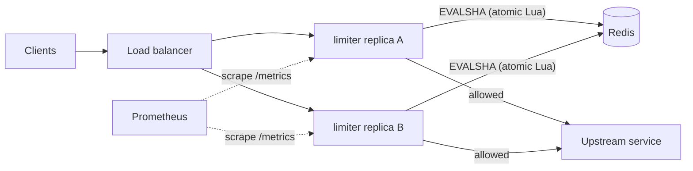
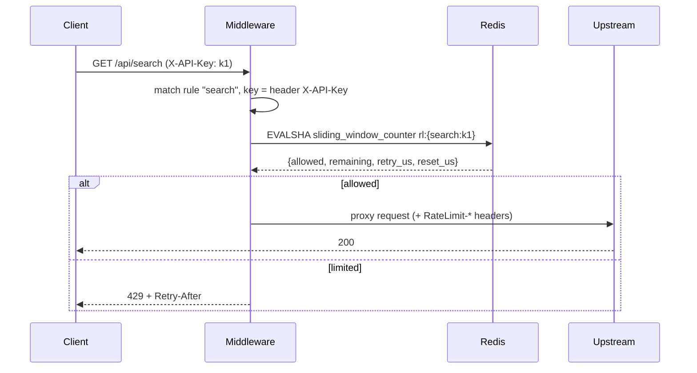

# RateLimiter

A distributed API rate limiter in Go, backed by Redis. Any number of app replicas share one Redis, and limits hold across all of them. Each decision is a single atomic Lua script that takes about 30 µs.

It ships as a gateway you can run in front of any HTTP service (`UPSTREAM_URL`), or as Go middleware you can drop into your own server.

- **Three algorithms:** token bucket, sliding window log and sliding window counter, chosen per route.
- **Atomic and skew-proof:** every check is one Redis Lua script that reads the clock with Redis `TIME`, so there are no read-modify-write races and no reliance on app server clocks.
- **Per-route YAML rules:** match on path prefix and method, then limit by client IP, API key header or a global budget. Rules can also give a request a weighted cost.
- **Standard headers:** `RateLimit-Limit`, `RateLimit-Remaining`, `RateLimit-Reset` and `RateLimit-Policy` (IETF draft), plus `Retry-After` on `429`.
- **Failure policy:** if Redis is down, fail open (serve traffic) or fail closed (`503`), set per deployment.
- **Observability:** Prometheus metrics for decisions, latency histograms and backend errors, plus `/healthz` and `/readyz`.
- **Tested:** 58 tests, including a concurrency test against real Redis. It fires 500 requests at once and checks that exactly 100 get through, for every algorithm.

## Architecture



Request flow inside one replica:



## Algorithms and trade-offs

| Algorithm | Redis state per key | Accuracy | Bursts | Good for |
|---|---|---|---|---|
| `token_bucket` | 1 hash (2 fields) | Exact | Allowed up to `burst`, then refills at `limit/window` | General API traffic |
| `sliding_window_log` | 1 sorted set, one entry per request | Exact, with no window-boundary bursts | No | Low limits that must be exact (login, OTP) |
| `sliding_window_counter` | 1 hash (3 fields) | Approximate: weights the previous window linearly | No | High limits where memory matters |

A **fixed window** counter lets a client send 2× the limit across a window boundary. Both sliding algorithms avoid that. The log version is exact but stores one entry per request. The counter version uses constant memory and assumes requests in the previous window were spread evenly.

**Why Lua plus Redis `TIME`?** Rate limiting is read-then-write. If two replicas each read "9 of 10 used" before either writes, both allow, and you get 11. A Lua script runs atomically on Redis, so that can't happen (`TestConcurrentAtomicity` checks this). Reading the time inside the script means every replica uses one clock, so skewed app servers can't hand out extra tokens.

**Keys** look like `rl:{rule:client}`. The braces form a Redis Cluster hash tag, so each script touches exactly one slot. Every key gets a TTL that matches its window, so idle clients cost no memory.

## Quick start

```bash
docker compose up --build        # Redis + 2 limiter replicas (:8081, :8082) + Prometheus (:9090)

for i in $(seq 25); do curl -s -o /dev/null -w "%{http_code} " localhost:8081/api/hello; done
# 200 x20 (burst) ... then 429

curl -i -X POST localhost:8082/api/login     # sliding window log: 5/min per IP, shared across replicas
curl localhost:8081/metrics | grep ratelimiter_
```

To run without Docker, you need a Redis on `localhost:6379`:

```bash
go run ./cmd/ratelimiter
```

## Configuration

Rules live in [`config/rules.yaml`](config/rules.yaml). The first matching rule wins, and `default` applies to everything else.

```yaml
failure_policy: open            # or "closed" -> 503 when Redis is down
rules:
  - name: login
    path_prefix: /api/login
    methods: [POST]
    algorithm: sliding_window_log
    limit: 5
    window: 1m
  - name: search
    path_prefix: /api/search
    algorithm: sliding_window_counter
    limit: 100
    window: 1m
    cost: 5                     # each call uses 5 units
    key: header:X-API-Key       # ip | global | header:<Name>
default:
  algorithm: token_bucket
  limit: 10                     # 10 per second sustained
  window: 1s
  burst: 20                     # bursts of up to 20
```

The rules file is validated strictly on startup. Unknown fields, bad durations, duplicate names and costs above capacity all fail fast.

| Env var | Default | Meaning |
|---|---|---|
| `LISTEN_ADDR` | `:8080` | HTTP listen address |
| `REDIS_ADDR` / `REDIS_PASSWORD` / `REDIS_DB` | `localhost:6379` / – / `0` | Redis connection |
| `RULES_PATH` | `config/rules.yaml` | Rules file |
| `UPSTREAM_URL` | – | Proxy allowed requests here. When unset, a built-in demo API answers |
| `TRUST_PROXY` | `false` | Use the first `X-Forwarded-For` address as the client IP |
| `REDIS_TIMEOUT` | `50ms` | Upper bound on each limiter call before the failure policy applies |
| `KEY_PREFIX` | `rl` | Redis key prefix |

## Using it as a library

```go
rdb := redis.NewClient(&redis.Options{Addr: "localhost:6379"})
lim := limiter.NewRedis(rdb, "rl")

res, err := lim.Allow(ctx, lim.Key("upload", userID), limiter.Rule{
    Algorithm: limiter.TokenBucket, Limit: 10, Window: time.Minute, Burst: 3,
}, 1)
if err == nil && !res.Allowed {
    // wait res.RetryAfter
}
```

## Metrics

| Metric | Type | Labels |
|---|---|---|
| `ratelimiter_decisions_total` | counter | `rule`, `algorithm`, `outcome` (`allowed`, `limited`, `error_allowed`, `error_rejected`) |
| `ratelimiter_decision_duration_seconds` | histogram | `rule`, `algorithm` |
| `ratelimiter_backend_errors_total` | counter | `rule` |

## Testing

```bash
make test          # unit tests (miniredis, fake clock): algorithms, config, middleware, server
make integration   # + real Redis: atomicity under concurrency, real-clock refill/expiry
make bench         # per-decision latency against real Redis
make load          # k6: 200 req/s across both replicas, checks shared limit + p99 < 50ms
```

The unit tests use [miniredis](https://github.com/alicebob/miniredis) with a controlled clock. That makes it possible to check exact refill amounts, `Retry-After` values and window-boundary behaviour without sleeping. CI runs `gofmt`, `go vet`, unit tests with `-race`, integration tests against a Redis service container, and a Docker build.

### Benchmarks

These come from `go test -tags integration -bench . ./internal/limiter/`, with 4 vCPU and local Redis 7, measuring parallel callers:

| Algorithm | ns/op |
|---|---|
| token_bucket | ~30,000 |
| sliding_window_counter | ~31,000 |
| sliding_window_log | ~37,000 |

The numbers are dominated by the Redis round trip. Each decision is one `EVALSHA`.

## Project layout

```
cmd/ratelimiter/      entrypoint: env config, Redis client, graceful shutdown
internal/limiter/     algorithms (Lua scripts) + Redis limiter + tests
internal/config/      YAML rules + env settings, strict validation
internal/middleware/  net/http middleware: rule matching, client keys, headers, failure policy
internal/metrics/     Prometheus collectors
internal/server/      routes: /healthz, /readyz, /metrics, demo API or reverse proxy
loadtest/             k6 scenario
deploy/               Prometheus scrape config
```

## License

MIT
